# Отчет по практической работе №2: Конечные автоматы

|                |                                          |
|----------------|------------------------------------------|
| **Дисциплина** | Теория автоматов, языков и вычислений    |
| **Тема**       | Регулярные выражения, грамматики и языки |
| **Вариант**    | № 6                                      |
| **Выполнил**   | Голубев Е. Е. КИ24-16/1Б                 |
| **Проверил**   | Кузнецов А. С.                           |

---

**Цель:** Реализация и исследование регулярных выражений, регулярных
грамматик и свойств регулярных языков, а также доказательство
нерегулярности языков.

**Постановка задачи (Вариант 6):**
1. **Часть 1:** Построить регулярное выражение, описывающее язык
   $L6 = \{\,a\,b^n\,w \mid n \ge 3,\; w \in \{a,b\}^+\,\}$, или формально
   доказать невозможность этого. Привести обобщенный граф переходов и
   эквивалентный КА, а также пошаговое выполнение преобразований.
2. **Часть 2:** Построить регулярную грамматику, описывающую язык $L6$,
   или формально доказать невозможность этого. Привести эквивалентный КА
   и РВ, а также пошаговое выполнение преобразований.
3. **Часть 3:** Доказать формально принадлежность или непринадлежность
   языка $L27 = \{\,a^n b^l a^k \mid k \ge n + l\,\}$ к классу РЯ с
   использованием леммы о разрастании регулярных языков.

---

## Файлы работы

* `RV.jff` — регулярное выражение и DFA для L6 (Часть 1)
* `RG.jff` — праволинейная грамматика и автомат для L6 (Часть 2)

---

## Часть 1. Построение регулярного выражения и конечного автомата для L6

### 1.1. Построение регулярного выражения

Язык $L6 = \{\,a\,b^n\,w \mid n \ge 3,\; w \in \{a,b\}^+\,\}$ задает цепочки,
которые:

1. начинаются с одного символа `a`;
2. затем содержат **не менее трёх** символов `b` подряд;
3. после этого идёт **непустая** цепочка $w$ над алфавитом $\{a,b\}$.

Минимальная длина цепочки языка — 5 символов (при $n=3$, $w$ из одного символа).

Регулярное выражение:

$$L6 = a\,b^3\,(a+b)^+$$

Пояснение:
- `a` — первый обязательный символ;
- `b^3` — три обязательных `b` (минимум для $n \ge 3$);
- `(a+b)^+` — непустая цепочка $w$ (хотя бы один символ `a` или `b`).

В среде JFLAP введенное выражение имеет вид:

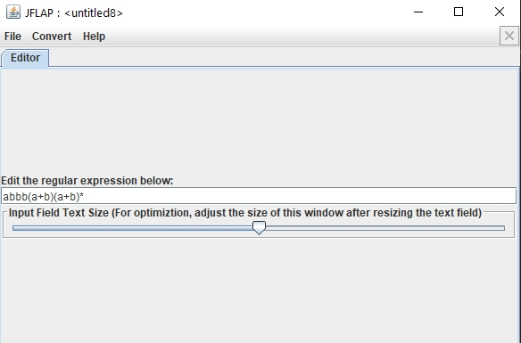

---

### 1.2. Пошаговое построение конечного автомата

Преобразование регулярного выражения в автомат выполнено путем
последовательного раскрытия базовых операций (конкатенация, объединение,
замыкание Клини) — по одному шагу на каждую операцию.

1. **Исходное РВ.** Обобщенный граф переходов с одной дугой, помеченной
   `abbb(a+b)(a+b)*`:

   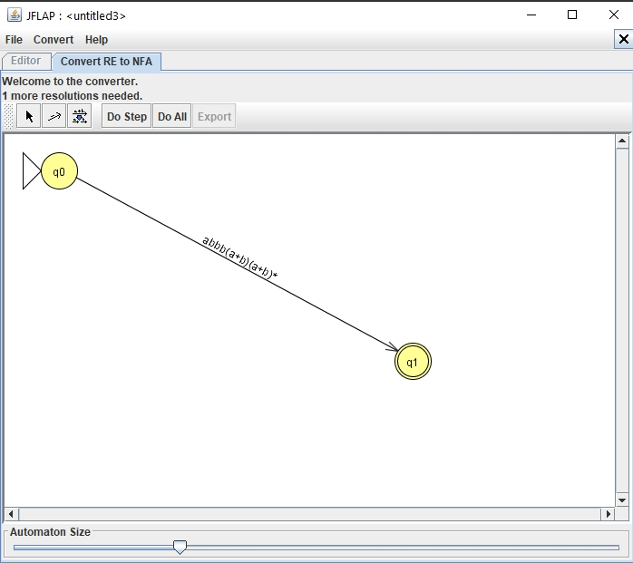

2. **Раскрытие конкатенации.** Первый символ `a` выделяется в отдельный
   переход, остаток подключается через λ-переходы:

   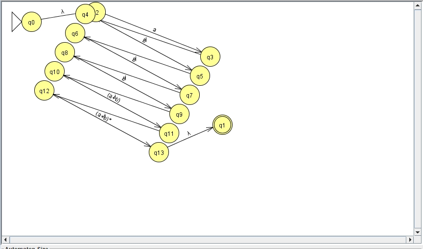

3. **Раскрытие `bbb`.** Создаются три последовательных перехода по
   символу `b`:

   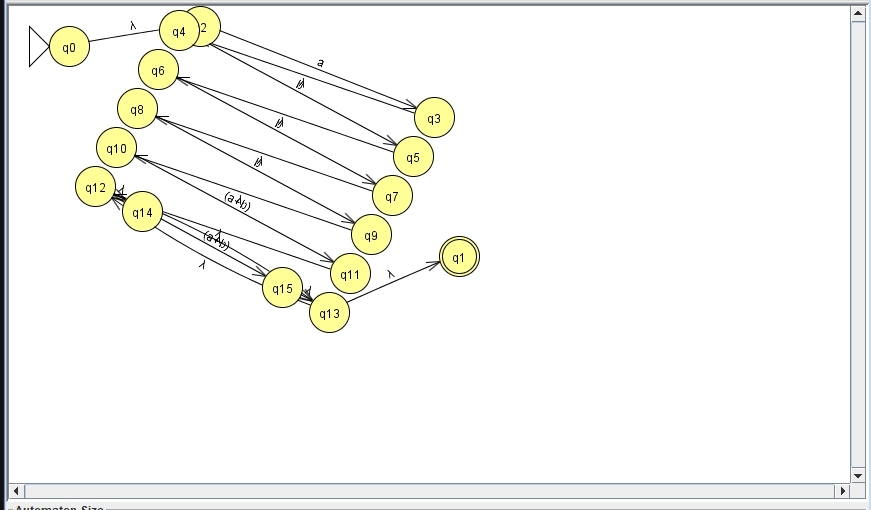

4. **Раскрытие `(a+b)`.** Добавляются параллельные переходы по `a` и по
   `b`, ведущие в одно состояние:

   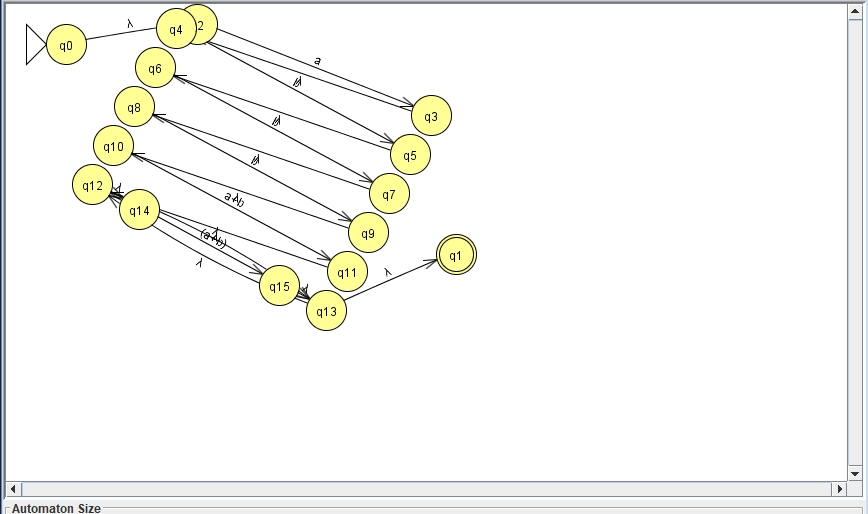

5. **Раскрытие `(a+b)*`.** Добавляются λ-переходы для цикла, позволяющего
   повторять символы `a` и `b`:

   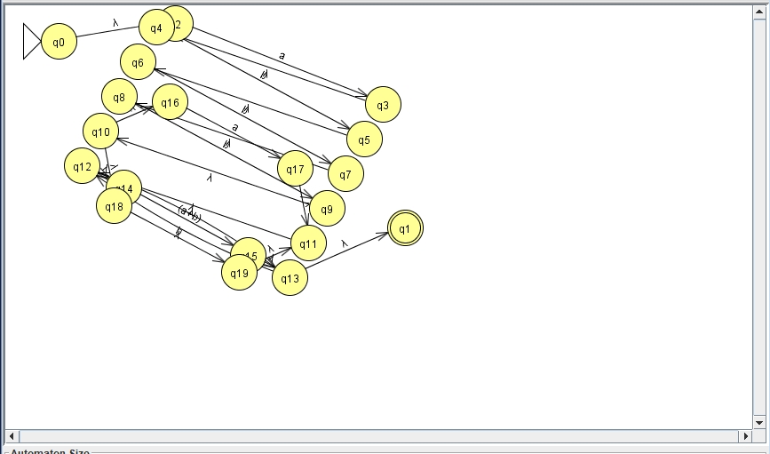

6. **Финальная сборка.** Итоговый NFA с 24 состояниями, начальное — `q0`,
   допускающее — `q1`:

   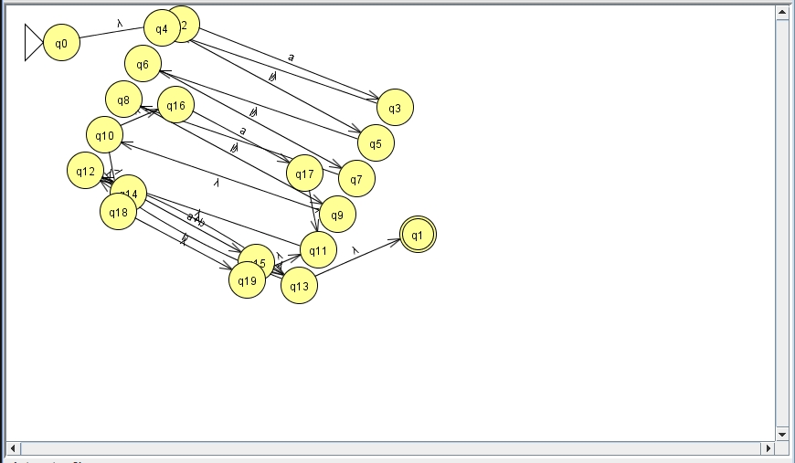
   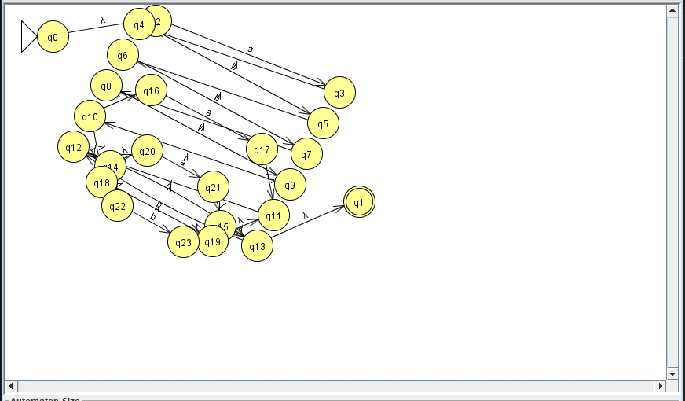

После детерминизации (`Convert → Convert to DFA`) и ручного построения
получен DFA на 6 состояний:

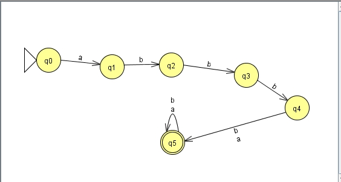

**Структура DFA:**

| Состояние | `a` | `b` | Комментарий |
|-----------|-----|-----|-------------|
| q0 | q1 | — | ожидаем первый `a` |
| q1 | — | q2 | 1-е обязательное `b` |
| q2 | — | q3 | 2-е обязательное `b` |
| q3 | — | q4 | 3-е обязательное `b` |
| q4 | q5 | q5 | начало $w$ (хотя бы 1 символ) |
| q5 | q5 | q5 | продолжение $w$ — **допускающее** |

Начальное: q0
Допускающее: q5

---

### 1.3. Тестирование автомата

Проверка работы автомата проведена в режиме **Input → Multiple Run** на
следующем наборе тестовых цепочек:

| Цепочка | Ожидаемый результат |
|---|---------------------|
| `abbba` | Accept |
| `abbbbb` | Accept |
| `abbbab` | Accept |
| `abbbba` | Accept |
| `abbb` | Reject |
| `abb` | Reject |
| `ab` | Reject |
| `baaaa` | Reject |

Автомат успешно принимает цепочки, начинающиеся с `a`, содержащие не
менее трёх `b` и хотя бы один символ после них, и отклоняет все прочие
строки:

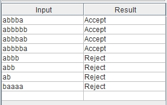

---

## Часть 2. Регулярная грамматика

### 2.1. Построение праволинейной грамматики

Для языка $L6$ составлена следующая праволинейная грамматика:

* $S \to aA$ — начинаем с `a`
* $A \to bB$ — первое обязательное `b`
* $B \to bC$ — второе обязательное `b`
* $C \to bD$ — третье обязательное `b`
* $D \to aE \mid bE$ — начало непустой цепочки $w$
* $E \to aE \mid bE$ — продолжение $w$
* $E \to a \mid b$ — завершение $w$

Стартовое правило $S$ фиксирует первый символ `a`. Нетерминалы $A$, $B$,
$C$ отсчитывают три обязательных `b`. Нетерминал $D$ обеспечивает
**непустоту** $w$: первый символ $w$ обязателен. Нетерминал $E$ реализует
произвольное продолжение $w \in \{a,b\}^*$ и завершает вывод терминалом.

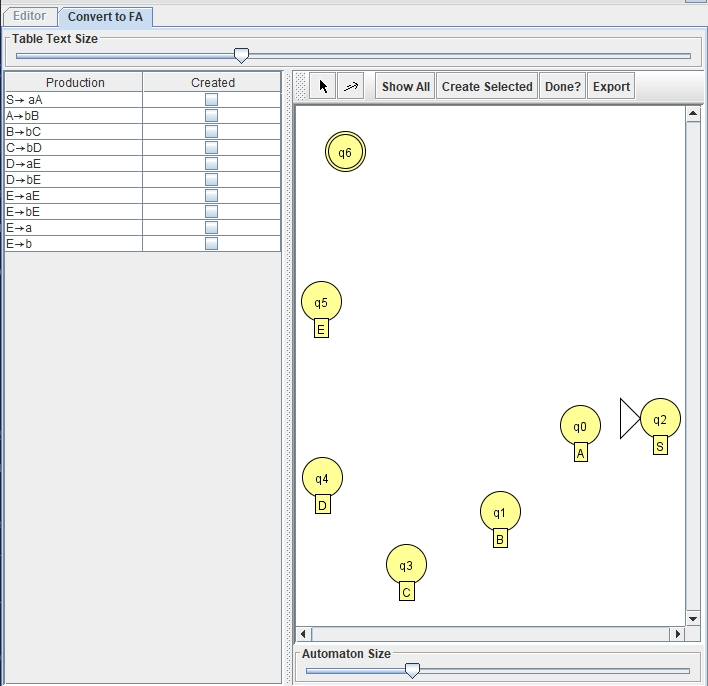

---

### 2.2. Построение КА по грамматике (Convert to FA)

Преобразование выполнено по стандартному алгоритму:

* Каждому нетерминалу сопоставлено состояние автомата
  ($S \to q_2$, $A \to q_0$, $B \to q_1$, $C \to q_3$, $D \to q_4$, $E \to q_5$);
* Правило вида $X \to aY$ (или $bY$) преобразуется в переход по
  соответствующему символу из $q_X$ в $q_Y$;
* Правило вида $E \to a$ (или $b$) ведет в выделенное финальное
  состояние $q_6$.

Пошаговое построение:

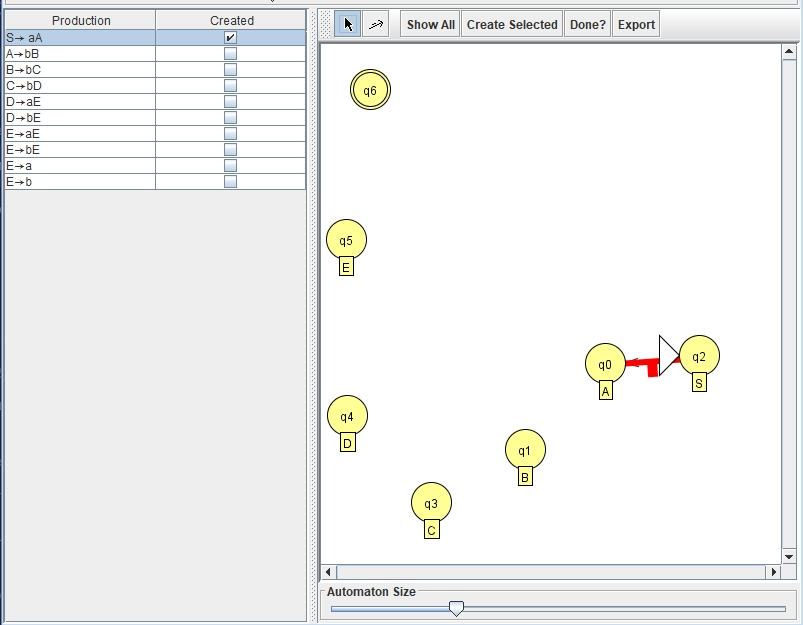

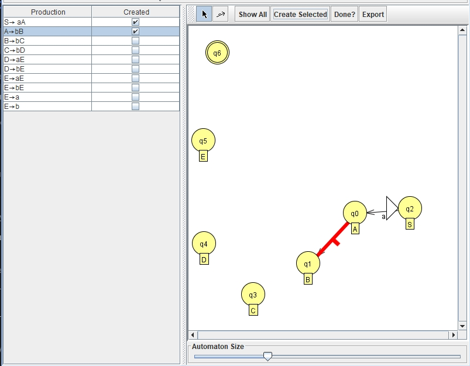
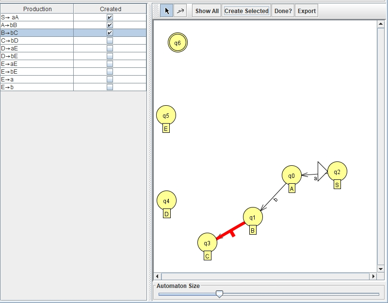
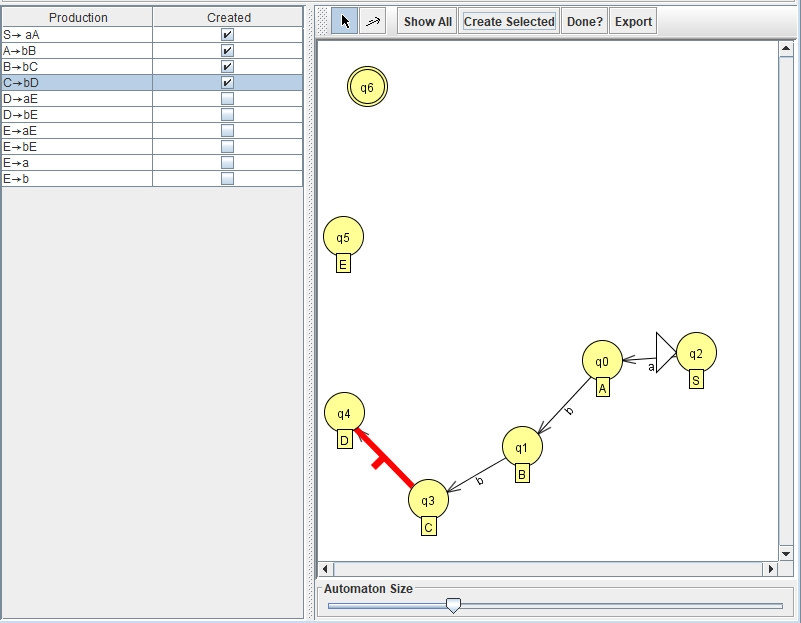
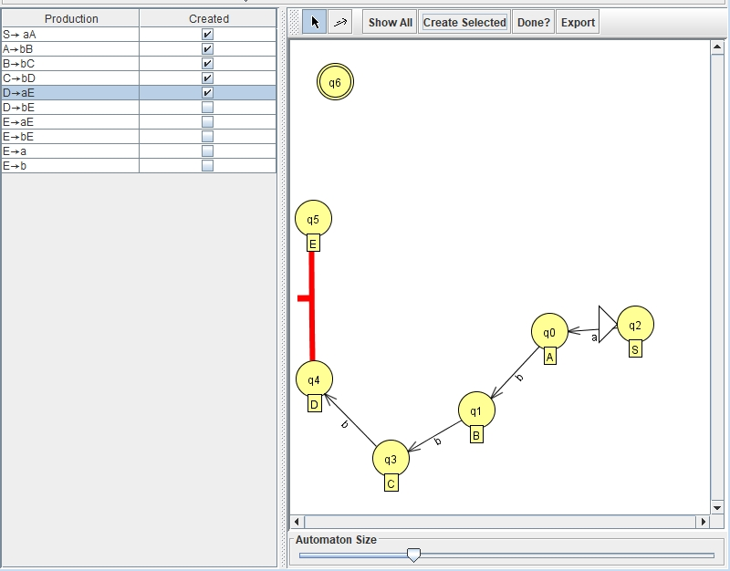
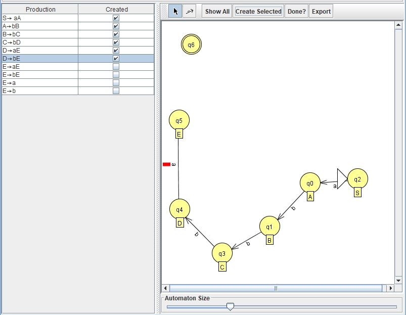
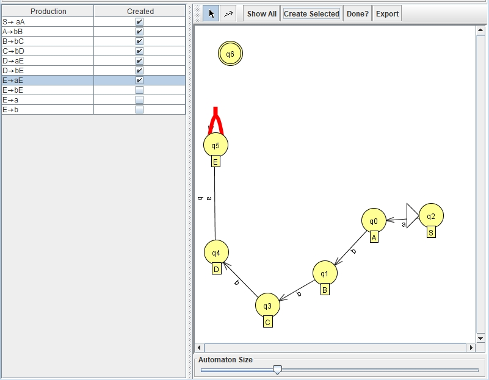
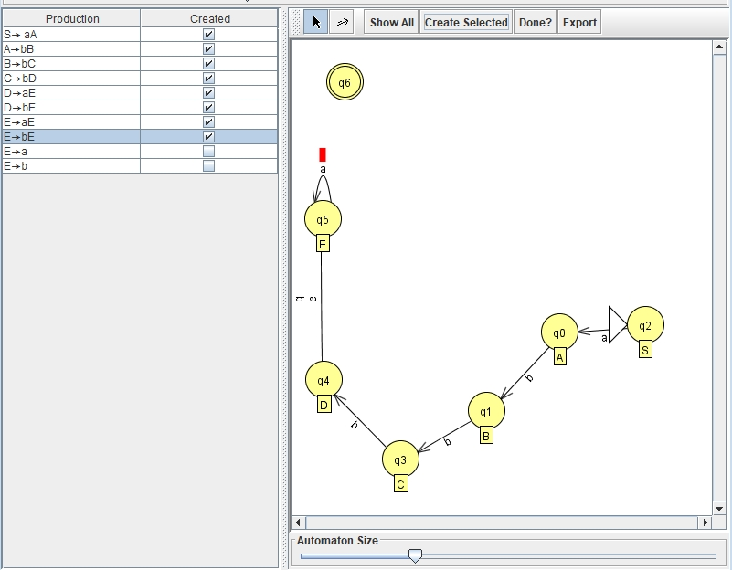
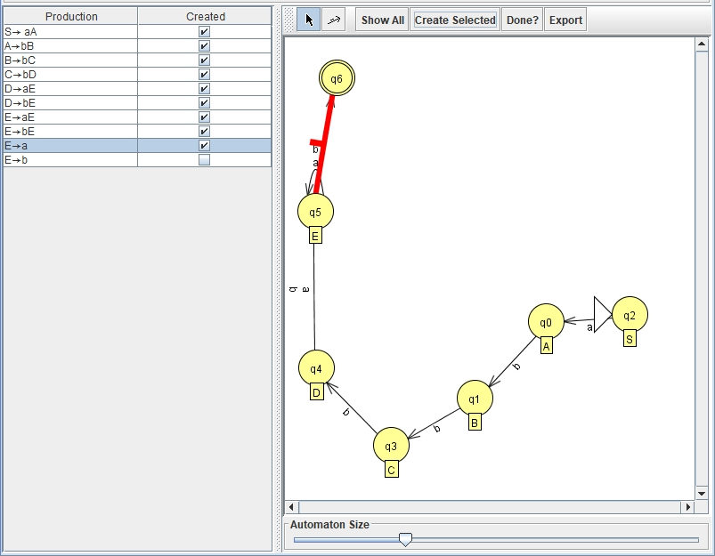
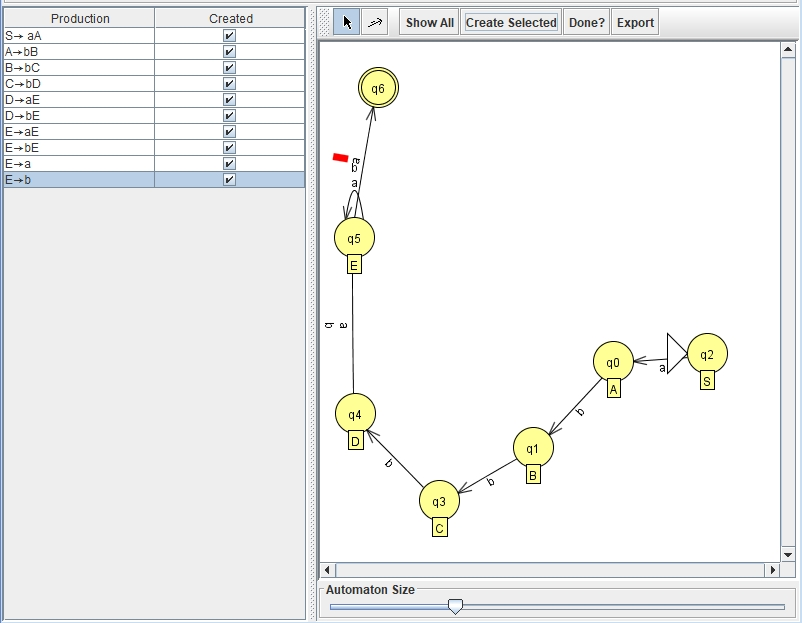

Итоговый вид полученного автомата:

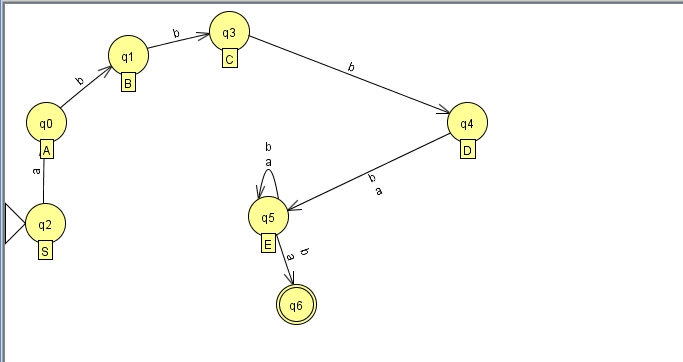

---

### 2.3. Тестирование построенного КА

Тестирование полученного автомата на том же наборе строк, что и в п. 1.3
(`Input → Multiple Run`), подтвердило эквивалентность языку $L6$: автомат
принимает `abbba`, `abbbbb`, `abbbab`, `abbbba` и отклоняет `abbb`, `abb`,
`ab`, `baaaa`:

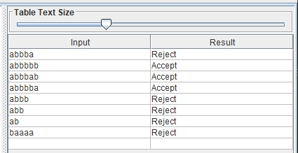

---

### 2.4. Преобразование конечного автомата в регулярное выражение (Convert FA to RE)

Обратное получение регулярного выражения выполнено методом
последовательного исключения состояний (State Collapser):

1. **Запуск преобразования.** В окне с автоматом RG.jff выбрано
   `Convert → Convert FA to RE`:

   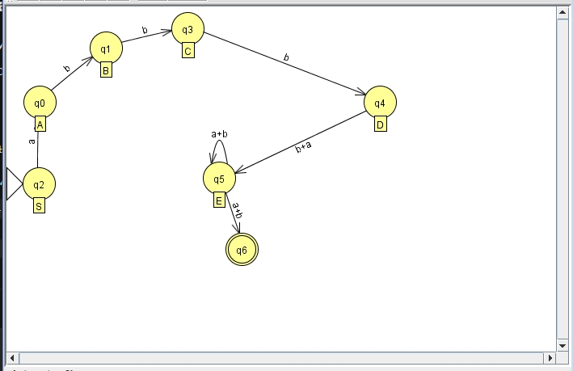

2. **Объединение параллельных переходов.** Кратные дуги между одной парой
   состояний заменены одной дугой с объединением символов: `q4 → q5` —
   `b+a`, петля `q5` — `a+b`, `q5 → q6` — `a,b`:

   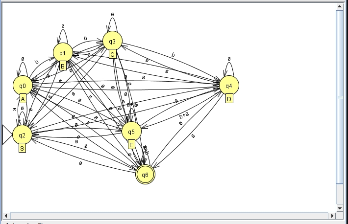

3. **Добавление ∅-переходов.** Между всеми несоединенными вершинами
   добавлены переходы по пустому множеству ∅:

   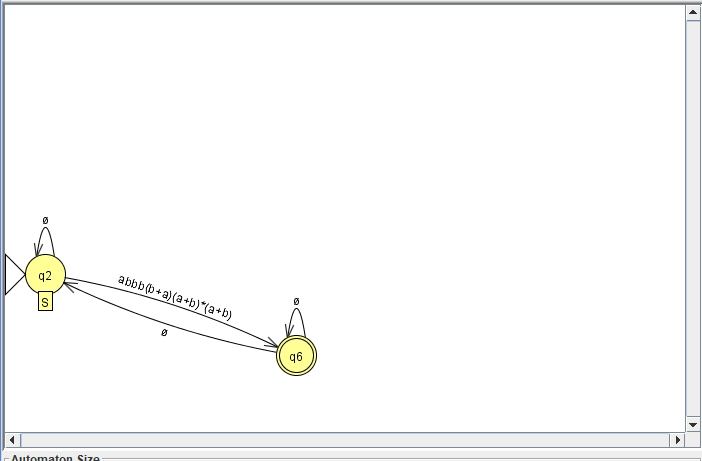

4. **Последовательное исключение промежуточных состояний.** При удалении
   каждой вершины пересчитываются регулярные выражения на проходящих
   через нее путях:

   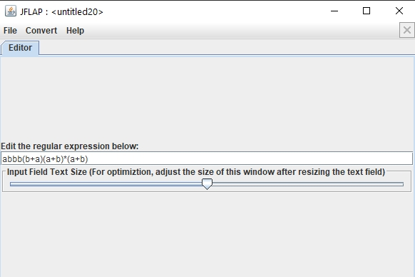

5. **Полученное регулярное выражение.** После исключения всех
   промежуточных состояний получено выражение:

   

   $$abbb(b+a)(a+b)^*(a+b)$$

   что эквивалентно исходному РВ из Части 1:

   $$abbb(a+b)(a+b)^*$$

Совпадение результата, полученного из грамматики, с исходным регулярным
выражением из Части 1 подтверждает корректность построенных РВ, КА и РГ
и их взаимную эквивалентность.

---

## Часть 3. Доказательство нерегулярности языка (лемма о разрастании)

**Язык:** $L_{27} = \{\,a^n b^l a^k \mid k \ge n + l\,\}$, где
$n, l, k \ge 0$ — целые числа.

**Утверждение.** Язык $L_{27}$ не является регулярным.

### Доказательство

Предположим противное: пусть $L_{27}$ регулярен. Тогда по лемме о
разрастании для регулярных языков существует константа накачки $p \ge 1$
такая, что любое слово $s \in L_{27}$ длины $|s| \ge p$ можно представить
в виде $s = xyz$, где:

- $|xy| \le p$;
- $|y| \ge 1$;
- $x y^i z \in L_{27}$ для любого $i \ge 0$.

**1. Выбор слова.** Возьмем $s = a^p b^p a^{2p}$. Проверим, что
$s \in L_{27}$:

- $n = p$, $l = p$, $k = 2p$;
- условие $k \ge n + l$: $2p \ge p + p = 2p$ — выполняется (равенство).

Длина $|s| = p + p + 2p = 4p \ge p$, поэтому к $s$ применима лемма.

**2. Анализ подстроки $y$.** По условию леммы $|xy| \le p$, поэтому
подстрока $xy$ целиком лежит внутри первых $p$ символов цепочки $s$, то
есть внутри блока $a^p$ (до первой буквы $b$). Значит,

$$x = a^r,\quad y = a^t,\quad z = a^{p-r-t} b^p a^{2p},$$

где $t \ge 1$, $r + t \le p$.

**3. Накачка при $i = 2$.** Рассмотрим цепочку

$$xy^2 z = a^{p+t} b^p a^{2p}.$$

**4. Проверка принадлежности $xy^2 z$ языку.** Если $xy^2 z \in L_{27}$,
то должно выполняться условие $k' \ge n' + l'$, где:

- $n' = p + t$ (количество `a` в первом блоке);
- $l' = p$ (количество `b`);
- $k' = 2p$ (количество `a` в последнем блоке).

Проверяем:

$$2p \ge (p + t) + p = 2p + t$$

$$0 \ge t$$

Но по условию леммы $t \ge 1$, значит $0 \ge t$ — **противоречие**.

**5. Противоречие.** Мы нашли $i = 2$, при котором накачанная цепочка
$xy^2 z$ не принадлежит языку $L_{27}$. Это нарушает условие леммы о
разрастании.

### Вывод

Полученное противоречие опровергает исходное предположение о
регулярности. Следовательно,

$$L_{27} = \{\,a^n b^l a^k \mid k \ge n + l\,\} \text{ не является регулярным языком.}$$

---

## Заключение

В ходе практической работы для языка $L6 = \{\,a\,b^n\,w \mid n \ge 3,\;
w \in \{a,b\}^+\,\}$ построено регулярное выражение $a\,b^3\,(a+b)^+$,
выполнено его пошаговое преобразование в конечный автомат в среде JFLAP,
а также составлена эквивалентная праволинейная регулярная грамматика с
обратным преобразованием в КА и РВ. Совпадение регулярных выражений,
полученных двумя независимыми путями (из исходного РВ и из грамматики
через автомат), подтвердило корректность построений. Корректность работы
автоматов проверена прогонами на контрольных наборах цепочек в режиме
Multiple Run. Для языка $L_{27} = \{a^n b^l a^k \mid k \ge n + l\}$ с
помощью леммы о разрастании аналитически доказана его нерегулярность.
