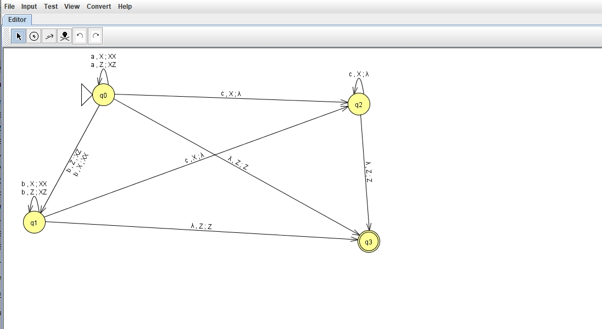
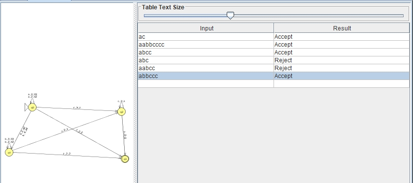
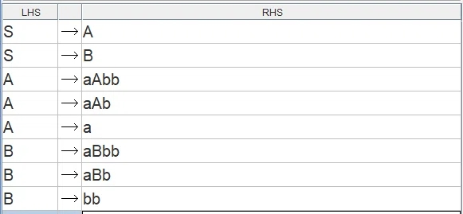
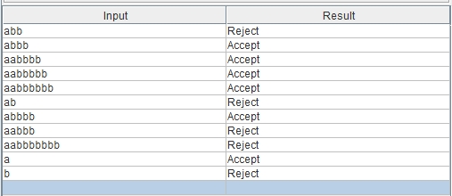

# Отчет по практической работе №3: Контекстно-свободные языки

|                |                                          |
|----------------|------------------------------------------|
| **Дисциплина** | Теория автоматов, языков и вычислений    |
| **Тема**       | Магазинные автоматы и КС-грамматики      |
| **Вариант**    | № 3                                      |
| **Выполнил**   | Голубев Е. Е. КИ24-16/1Б                 |
| **Проверил**   | Кузнецов А. С.                           |

---

**Цель:** Реализация и исследование магазинных автоматов (МПА),
контекстно-свободных грамматик и свойств КС-языков, а также
доказательство неконтекстно-свободности языков.

**Постановка задачи (Вариант 3):**

1. **Часть 1:** Построить МПА для языка $L3 = \{a^n b^m c^{m+n} \mid n \ge 0, m \ge 0\}$, либо доказать невозможность. Предложить программную реализацию МПА.
2. **Часть 2:** Построить КС-грамматику для языка $L19 = \{a^n b^m \mid n \neq 2m, m \ge 0, n \ge 0\}$, либо доказать невозможность.
3. **Часть 3:** Доказать формально контекстно-свободность или ее отсутствие для языка $L35 = \{w \in \{a,b,c\}^* \mid n_a(w) + n_b(w) = 2n_c(w)\}$.

---

## Файлы работы

* `PDA.jff` — магазинный автомат для L3 (Часть 1)
* `CFG.jff` — контекстно-свободная грамматика для L19 (Часть 2)
* `pda.py` — программная реализация МПА (бонус)

---

## 1. Построение МПА для языка L3

### 1.1. Анализ языка

Язык $L3 = \{a^n b^m c^{m+n} \mid n \ge 0, m \ge 0\}$ состоит из цепочек,
где сначала идут $n$ букв `a`, затем $m$ букв `b`, а затем ровно $m+n$
букв `c`.

**Идея автомата:** магазин (стек) используется как счетчик. При чтении
каждой `a` и каждой `b` в стек кладется маркер `X`. При чтении `c`
маркер снимается. Строка принимается, если к концу строки стек опустел
до дна (`Z`).

### 1.2. Формальное описание МПА

**Множество состояний:** $Q = \{q_0, q_1, q_2\}$
**Входной алфавит:** $\Sigma = \{a, b, c\}$
**Алфавит магазина:** $\Gamma = \{Z, X\}$
**Начальное состояние:** $q_0$
**Начальный символ магазина:** $Z$
**Множество финальных состояний:** $F = \{q_2\}$

**Функция переходов:**

| Состояние | Вход | Снять со стека | Положить в стек | Новое состояние |
|-----------|------|----------------|-----------------|-----------------|
| q0 | a | Z | XZ | q0 |
| q0 | a | X | XX | q0 |
| q0 | b | Z | XZ | q1 |
| q0 | b | X | XX | q1 |
| q1 | b | X | XX | q1 |
| q1 | c | X | (пусто) | q2 |
| q2 | c | X | (пусто) | q2 |
| q2 | λ | Z | Z | q2 |

*МПА принимает цепочки **по финальному состоянию** $q_2$.*

### 1.3. Визуализация и тестирование в JFLAP

Построенный магазинный автомат в среде JFLAP:



Тестирование МПА (режим **Input → Multiple Run**):



Тестирование в режиме **Input → Multiple Run**:

| Цепочка | Принадлежит \(L3\) | Результат |
|---------|---------------------|-----------|
| `ac` | да (\(n=1, m=0\)) | принята |
| `aabbcccc` | да (\(n=2, m=2\)) | принята |
| `abcc` | да (\(n=1, m=1\)) | принята |
| `abc` | нет (не хватает одной `c`) | отвергнута |
| `aabcc` | нет (не хватает одной `c`) | отвергнута |
| `abbccc` | да (\(n=1, m=2\)) | принята |

### 1.5. Программная реализация МПА

Программная реализация МПА на языке Python (эмуляция стека и
переходов):

```python
class PDA:
    def __init__(self):
        self.stack = ['Z']
        self.state = 'q0'

    def process(self, word):
        self.stack = ['Z']
        self.state = 'q0'
        
        for char in word:
            if self.state == 'q0':
                if char == 'a':
                    self.stack.append('X')
                elif char == 'b':
                    self.state = 'q1'
                    self.stack.append('X')
                elif char == 'c':
                    self.state = 'q2'
                    if len(self.stack) > 1 and self.stack[-1] == 'X':
                        self.stack.pop()
                    else:
                        return False
                else:
                    return False
                    
            elif self.state == 'q1':
                if char == 'b':
                    self.stack.append('X')
                elif char == 'c':
                    self.state = 'q2'
                    if len(self.stack) > 1 and self.stack[-1] == 'X':
                        self.stack.pop()
                    else:
                        return False
                else:
                    return False
                    
            elif self.state == 'q2':
                if char == 'c':
                    if len(self.stack) > 1 and self.stack[-1] == 'X':
                        self.stack.pop()
                    else:
                        return False
                else:
                    return False
                    
        return self.state == 'q2' and self.stack == ['Z']

# Тестирование
pda = PDA()
tests = ["ac", "aabbcccc", "abcc", "abc", "aabcc", "abbccc"]
for t in tests:
    result = pda.process(t)
    print(f"Строка {t}: {'Accept' if result else 'Reject'}")

```
## 2. Построение КС-грамматики для языка L19

### 2.1. Анализ языка

Язык \(L19 = \{ a^n b^m \mid n \neq 2m, m \ge 0, n \ge 0 \}\).
Условие \(n \neq 2m\) разбивается на два случая:
1. \(n < 2m\) (лишние `b`)
2. \(n > 2m\) (лишние `a`)

**Грамматика:**
* \(S \to A \mid B\)
* \(A \to aAb \mid aAbb \mid a\) (генерирует \(n > 2m\), всегда есть лишняя `a`)
* \(B \to aBb \mid aBbb \mid bb\) (генерирует \(n < 2m\), всегда есть лишние `b`)

### 2.2. Визуализация грамматики

Построенная грамматика в JFLAP:



### 2.3. Проверка генерации

Проверка вывода строк в JFLAP (**Input → Brute Force Parse**):



Проверка вывода строк в JFLAP:

| Цепочка | Принадлежит \(L19\) | Результат |
|---------|---------------------|-----------|
| `abb` | нет (баг JFLAP) | отвергнута |
| `abbb` | да (\(n=1, m=3\)) | принята |
| `aabbbb` | да (\(n=2, m=4\)) | принята |
| `aabbbbb` | да (\(n=2, m=5\)) | принята |
| `aabbbbbbb` | да (\(n=2, m=7\)) | принята |
| `ab` | нет (баг JFLAP) | отвергнута |
| `abbbb` | да (\(n=1, m=4\)) | принята |
| `aabbb` | да (\(n=2, m=3\)) | принята |
| `aabbbbbbbb` | да (\(n=2, m=8\)) | принята |
| `a` | да (\(n=1, m=0\)) | принята |
| `b` | нет (нет `a`) | отвергнута |

---

## 3. Доказательство неконтекстно-свободности языка L35

**Язык:** \(L35 = \{ w \in \{a,b,c\}^* \mid n_a(w) + n_b(w) = 2n_c(w) \}\).

**Утверждение:** Язык \(L35\) не является контекстно-свободным.

### Доказательство

Предположим противное: пусть \(L35\) является контекстно-свободным.
Тогда по лемме о разрастании для КС-языков существует константа
накачки \(p \ge 1\).

**1. Выбор слова.** Возьмем \(s = a^p b^p c^p\). Оно принадлежит языку,
так как \(n_a + n_b = p + p = 2p\), и \(2n_c = 2p\). Равенство
выполняется. Длина слова \(|s| = 3p \ge p\).

**2. Разбиение.** По лемме \(s = u v x y z\), где \(|vxy| \le p\),
\(|vy| \ge 1\). Подстрока \(vxy\) не может содержать все три типа
символов (так как блоки \(a\), \(b\) и \(c\) имеют длину \(p\)).

**3. Накачка при \(i=2\).** При удвоении \(v\) и \(y\):
* Если они состоят из \(a\) и/или \(b\), увеличится левая часть
  уравнения (\(n_a + n_b\)), а правая (\(2n_c\)) останется прежней.
* Если они состоят из \(c\), увеличится правая часть, а левая
  останется прежней.

**4. Противоречие.** В любом случае условие \(n_a + n_b = 2n_c\)
нарушается, и слово выходит из языка. Это противоречит лемме.

### Вывод

Полученное противоречие доказывает, что язык \(L35\) **не является
контекстно-свободным**.

## 4. Заключение

В ходе практической работы были исследованы свойства контекстно-свободных языков. 

Для языка `L3 = { a^n b^m c^(m+n) }` успешно построен магазинный автомат, принимающий цепочки по финальному состоянию. Также написана и протестирована программная реализация данного МПА на языке Python, эмулирующая работу стека, что подтверждает практическое применение теории автоматов.

Для языка `L19 = { a^n b^m | n != 2m }` составлена контекстно-свободная грамматика, разбивающая условие на два случая (с преобладанием `a` и с преобладанием `b`). Корректность вывода строк проверена в среде JFLAP.

Для языка `L35 = { w принадлежит {a,b,c}* | n_a(w) + n_b(w) = 2n_c(w) }` с помощью леммы о разрастании для КС-языков аналитически доказана его неконтекстно-свободность. Использование слова-ловушки `s = a^p b^p c^p` и последующая накачка показали, что условие баланса символов неизбежно нарушается, что делает невозможным построение для него МПА или КС-грамматики.